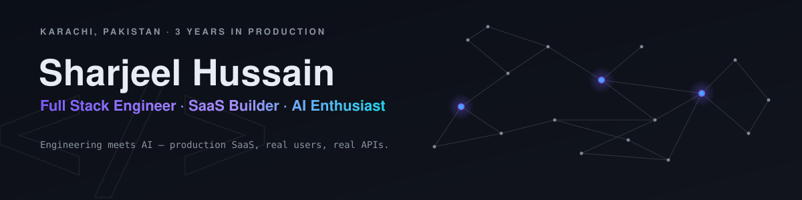
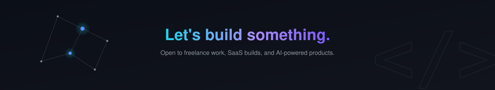

  

  <a href="https://sharjeelhussain.vercel.app">Portfolio</a> ·
  <a href="mailto:dev.sharjeelhussain@gmail.com">Email</a> ·
  <a href="https://pk.linkedin.com/in/SharjeelHussain877">LinkedIn</a> ·
  <a href="https://x.com/shrjilhussain">X</a> ·
  <a href="https://cal.com/sharjeel-hussain-877/quick-chat">Book a call</a>

## 01 · The Signal
<b>WHO I AM</b>

I'm a Full Stack Engineer, SaaS builder, and AI enthusiast based in Karachi, Pakistan. For the past 3 years I've been turning ideas into production software — React and Next.js on the front end, Node.js on the back end, and the databases that hold it all together.

More recently, a growing part of that work is wiring large language models into real products: RAG pipelines, AI agents, and automation — not as a gimmick bolted on at the end, but as a core part of how the product, and how I build it, actually works.

> Keep the stack simple and the process clear.

## 02 · The Process
<b>HOW I TURN IDEAS INTO PRODUCTION</b>

- **Start from the data model.** Screens change; the shape of the data usually doesn't. Schemas and API contracts come before UI.
- **Ship in vertical slices.** One real flow working end to end beats ten screens with nothing behind them yet.
- **Design for the second customer, not just the first demo.** Multi-tenant thinking, auth, and roles get built in early — retrofitting them later is where SaaS projects stall.
- **Treat the API as the real product.** The frontend is a client of it, not the other way around — which is also what lets a future mobile app, or an AI agent, use the same backend.

## 03 · The Edge
<b>AI & INNOVATION</b>

AI sits on both sides of my work: inside the products I ship, and inside how I ship them.

- **In the product** — integrating LLM APIs into real features, building RAG pipelines over a client's own data, and designing AI agents that do one job well instead of a chat window that tries to do everything.
- **In the workflow** — `Claude`, `Cursor`, and `GitHub Copilot` are part of my daily toolchain for scaffolding, refactoring, and catching mistakes early, so more time goes into architecture and product decisions than boilerplate.

## 04 · The Output
<b>THINGS I'VE BUILT</b>

| Project | What it is |
|---|---|
| [**Schoolovic**](https://schoolovic.vercel.app) | Cloud-based school management system (ERP) — student records, exams, QR attendance, and multi-campus management. |
| [**FlowKanvas**](https://flowkanvas.vercel.app) | A developer-first PDF API that generates documents from reusable templates with auto-detected variables. |
| [**Moment Acclaim**](https://www.momentacclaim.com) | Turns photos and messages into personalized digital keepsakes that open through a private link. |
| **QueLess City** | A virtual queue management app for businesses and customers. *(private project — no public link yet)* |

## 05 · The Stack
<b>TECHNOLOGY</b>

<table>
<tr>
<td align="center" width="25%"><b>Frontend</b></td>
<td align="center" width="25%"><b>Backend</b></td>
<td align="center" width="25%"><b>Databases & Cloud</b></td>
<td align="center" width="25%"><b>Tools</b></td>
</tr>
<tr>
<td align="center"></td>
<td align="center"></td>
<td align="center"></td>
<td align="center"></td>
</tr>
<tr>
<td>React.js · Next.js · TypeScript · JavaScript · HTML5 &amp; CSS3 · Tailwind CSS · Shadcn UI · Material UI · Redux Toolkit</td>
<td>Node.js · Express.js · REST APIs · API Integration · Authentication &amp; Authorization</td>
<td>PostgreSQL · MongoDB · Supabase · Firebase · Firestore · Cloudinary · Vercel</td>
<td>Git · GitHub · Postman · NPM · Yarn</td>
</tr>
</table>

## 06 · The Path
<b>EXPERIENCE & JOURNEY</b>

- **Angle Brackets** — Full Stack Engineer · *Present*
  Building full-stack web products end to end: data models, APIs, and the front ends on top of them.
- **SCMDOJO** — MERN Stack Developer
  Shipped features for a supply chain learning platform.
- **Coderx** — Full Stack Engineer
  Delivered client web applications with React front ends and Node.js services.
- **Nubit Software** — MERN Stack Developer
  Developed and maintained applications for software house clients.

## 07 · The Pulse
<b>GITHUB ACTIVITY</b>

  

  
  

## 08 · The Invite
<b>LET'S BUILD SOMETHING</b>

  

  <a href="https://sharjeelhussain.vercel.app">Portfolio</a> ·
  <a href="https://cal.com/sharjeel-hussain-877/quick-chat">Book a call</a> ·
  <a href="mailto:dev.sharjeelhussain@gmail.com">Email</a> ·
  <a href="https://pk.linkedin.com/in/SharjeelHussain877">LinkedIn</a>

