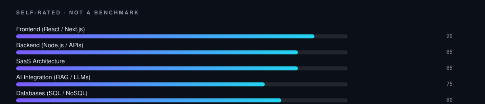

<p align="center">
  <a href="https://sharjeelhussain.vercel.app">
    
  </a>
</p>

<p align="center">
  <a href="https://sharjeelhussain.vercel.app"></a>
  <a href="https://pk.linkedin.com/in/SharjeelHussain877"></a>
  <a href="mailto:dev.sharjeelhussain@gmail.com"></a>
  <a href="https://cal.com/sharjeel-hussain-877/quick-chat"></a>
</p>

<p align="center">
  
</p>

---

## 🎮 Player Select

<table>
  <tr>
    <td width="34%" align="center" valign="middle">
      
    </td>
    <td width="66%" valign="top">

<sub><b>🟢 ONLINE</b> — open to freelance &amp; contract work</sub>

```yaml
player:        Sharjeel Hussain
class:         Full Stack Engineer · SaaS Builder · AI Enthusiast
current_guild: Angle Brackets  # Full Stack Engineer
spawn_point:   Karachi, Pakistan 🇵🇰
experience:    3 years
main_weapon:   React / Next.js ⚔️
side_weapon:   Node.js + AI integrations 🛡️
special_move:  "Keeps the stack simple and the process clear."
status:        Open to freelance & contract work
```

</td>
  </tr>
</table>

> **Lore:** A full-stack engineer who ships complete SaaS products — React/Next.js front ends, Node.js
> services, and the databases and APIs underneath. Increasingly builds AI directly into them too:
> RAG pipelines, LLM integrations, and AI agents. From first screen to production, with
> **Claude**, **Cursor**, and **GitHub Copilot** in the toolchain along the way.

<p align="center">
  <b>🕹️ Try my live builds →</b>
  <a href="https://schoolovic.vercel.app"></a>
  <a href="https://flowkanvas.vercel.app"></a>
  <a href="https://www.momentacclaim.com"></a>
  
</p>

---

## 📊 Character Stats

<p align="center">
  
</p>

---

## 🧰 Inventory · Skill Tree

<table>
  <tr>
    <td align="center" width="25%"><b>🖥️ Frontend</b><br /><sub>Core</sub></td>
    <td align="center" width="25%"><b>🗄️ Backend &amp; Database</b><br /><sub>Core</sub></td>
    <td align="center" width="25%"><b>☁️ Cloud &amp; Services</b><br /><sub>Deploy</sub></td>
    <td align="center" width="25%"><b>🛠️ Tools &amp; Workflow</b><br /><sub>Always equipped</sub></td>
  </tr>
  <tr>
    <td align="center"></td>
    <td align="center"></td>
    <td align="center"></td>
    <td align="center"></td>
  </tr>
  <tr>
    <td><sub>React.js · Next.js · TypeScript · JavaScript · HTML5 &amp; CSS3 · Tailwind CSS · Shadcn UI · Material UI · Redux Toolkit</sub></td>
    <td><sub>Node.js · Express.js · PostgreSQL · MongoDB · REST APIs · Auth</sub></td>
    <td><sub>Supabase · Firebase · Firestore · Cloudinary · Vercel</sub></td>
    <td><sub>Git &amp; GitHub · Postman · NPM &amp; Yarn · AI-assisted dev (Claude, Cursor, Copilot)</sub></td>
  </tr>
</table>

---

## 🧭 Guild History

| Chapter | Guild | Role |
|---|---|---|
| **Current** | **Angle Brackets** | Full Stack Engineer |
| Earlier | **SCMDOJO** | MERN Stack Developer |
| Earlier | **Coderx** | Full Stack Engineer |
| Earlier | **Nubit Software** | MERN Stack Developer |

<sub>Exact dates aren't public yet — chapters are ordered current → earliest.</sub>

---

## 📈 Live Scoreboard

<p align="center">
  
  
</p>

<p align="center">
  
</p>

---

## 🛒 Shop · Services for Hire

| Item | What you get |
|---|---|
| 🌐 **Website / Web App** | Responsive sites and web apps with React &amp; Next.js |
| 🏫 **SaaS &amp; Dashboards** | Multi-tenant platforms and admin panels in Next.js |
| 🔌 **Backend &amp; APIs** | Node.js / Express, PostgreSQL, MongoDB, Supabase, Firebase, auth |
| 🤖 **AI Integration** | LLM APIs, RAG pipelines, and AI agents wired into real products |
| 🛍️ **Deployment &amp; Redesigns** | Shipping to Vercel, cleaner and faster UIs |

---

## 🕹️ Continue?

<p align="center">
  <b>Got a project, a role, or a boss you can't beat alone?</b><br />
  <sub>Insert coin below — Player 2 is always welcome. 🪙</sub>
  <br /><br />
  <a href="https://sharjeelhussain.vercel.app"></a>
  <a href="mailto:dev.sharjeelhussain@gmail.com"></a>
  <a href="https://pk.linkedin.com/in/SharjeelHussain877"></a>
  <a href="https://cal.com/sharjeel-hussain-877/quick-chat"></a>
</p>

<p align="center">
  
</p>
